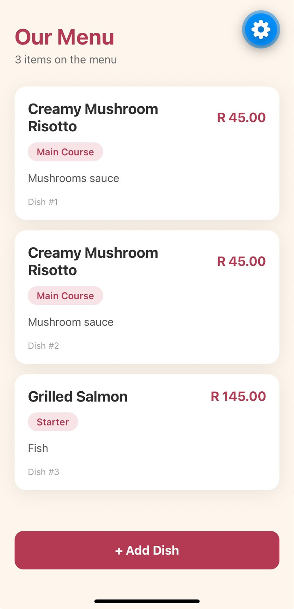
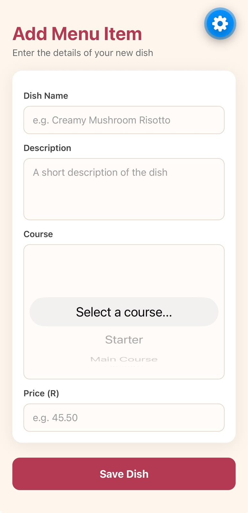

Chef's Menu Manager

MAST5112 - Mobile App Scripting - Portfolio of Evidence (Part 2)

Student Information

Full name: Basim Ubaid Akhtar
Student number: ST10516576
Institution: The Independent Institute of Education (IIE)

About the App

Chef's Menu Manager is a React Native app for Christoffel's Kitchen. The chef used to keep the menu on paper, which made it hard to update dishes and find information. This app lets the chef add menu items and view them all in one place from a phone.

What the App Can Do (Part 2)

- Add a menu item with a dish name, description, course and price.
- Choose the course (Starter, Main Course or Dessert) from a dropdown picker, so spelling mistakes are impossible.
- See every added dish in a scrollable list, newest last.
- The list updates by itself the moment a dish is added.
- A green confirmation banner shows on the menu screen after a successful save.
- A friendly message shows when the menu is empty.
- Each field is validated: empty fields are rejected, and the price must be a number greater than 0.
- Error messages appear in red directly under the field that is wrong, and disappear while the chef types.
- Menu items are saved to the phone with AsyncStorage, so they stay after the app is closed (AsyncStorage, 2026).

Screens

Menu screen ("Our Menu")
- The app title and a count of the items on the menu.
- Dish cards showing the name, price, course badge, description and dish number, rendered with FlatList so long menus stay smooth (React Native, 2026).
- An empty state message when nothing has been added yet.
- An "Add Dish" button at the bottom.

Add Menu Item screen
- TextInput fields for the dish name and description (multi-line) (React Native, 2026).
- A Picker dropdown for the course with a "Select a course..." prompt (React Native Picker, 2026).
- A numeric keypad input for the price.
- Save Dish and Cancel buttons.
- Inline red validation messages under each field.

Screenshots

Tech Stack

- Expo SDK 57 with React Native 0.86 (Expo, 2026).
- React Navigation (native stack) for moving between the two screens (React Navigation, 2026).
- @react-native-picker/picker for the course dropdown (React Native Picker, 2026).
- @react-native-async-storage/async-storage for saving the menu (AsyncStorage, 2026).
- react-native-safe-area-context so content never hides behind notches or system bars.

How to Run It

Option A: Android Studio emulator

1. Check Node is installed by running node -v in a terminal (Expo, 2026).
2. Open Android Studio and create a device in the Device Manager (for example Pixel 9a), then press the play button to start it.
3. Open this folder in a terminal and run: npm install
4. Start the app: npx expo start
5. Press "a" in the terminal. Expo Go downloads and installs on the emulator by itself, and the app opens.

Option B: phone with Expo Go

1. Install the Expo Go app on your phone.
2. Open this folder in a terminal and run: npm install, then npx expo start
3. Scan the QR code with Expo Go (phone and computer must be on the same Wi-Fi).
4. If the connection fails, stop the server with Ctrl+C and run: npx expo start --tunnel, then scan the QR code again.

Folder Structure

App.js            - the two screens and navigation are set up here
theme.js          - shared colours and spacing for a consistent layout
storage.js        - save and load menu items with AsyncStorage
screens/MenuScreen.js      - the menu list
screens/AddDishScreen.js   - the form to add a dish
assets/           - icons and splash image

Video Demonstration Checklist

The 3-5 minute screen recording covers these points:

1. Open the app and show the empty menu message.
2. Tap "Add Dish" and try to save without filling anything in - show the red error messages.
3. Type an invalid price (for example -5 or abc) and show the price error.
4. Fill in all four fields correctly, pick a course from the dropdown and save - show the green confirmation banner.
5. Add two more dishes and show all three in the list, with the item count updating.
6. Close and reopen the app to show the menu is still there.

Changelog

5 October 2026 - scaffolded the Expo project and installed navigation, picker and storage packages.
5 October 2026 - built the Menu screen with FlatList, empty state, confirmation banner and Add Dish button.
5 October 2026 - built the Add Menu Item screen with the four inputs, course picker and inline validation.
5 October 2026 - added AsyncStorage so the menu survives an app restart.
5 October 2026 - verified the project with expo-doctor (21/21 checks) and an Android bundle export.
5 October 2026 - wrote this README with run instructions and the video checklist.
12 October 2026 - added screenshots of the menu screen and the add menu item screen to the README.

References

AsyncStorage. 2026. React Native Async Storage documentation. [Online] Available at: https://react-native-async-storage.github.io/async-storage/ [Accessed 5 October 2026].

Expo. 2026. Expo documentation. [Online] Available at: https://docs.expo.dev [Accessed 5 October 2026].

React Native. 2026. Core components and APIs. [Online] Available at: https://reactnative.dev/docs/components-and-apis [Accessed 5 October 2026].

React Native Picker. 2026. @react-native-picker/picker documentation. [Online] Available at: https://github.com/react-native-picker/picker [Accessed 5 October 2026].

React Navigation. 2026. Getting started with React Navigation. [Online] Available at: https://reactnavigation.org/docs/getting-started [Accessed 5 October 2026].
